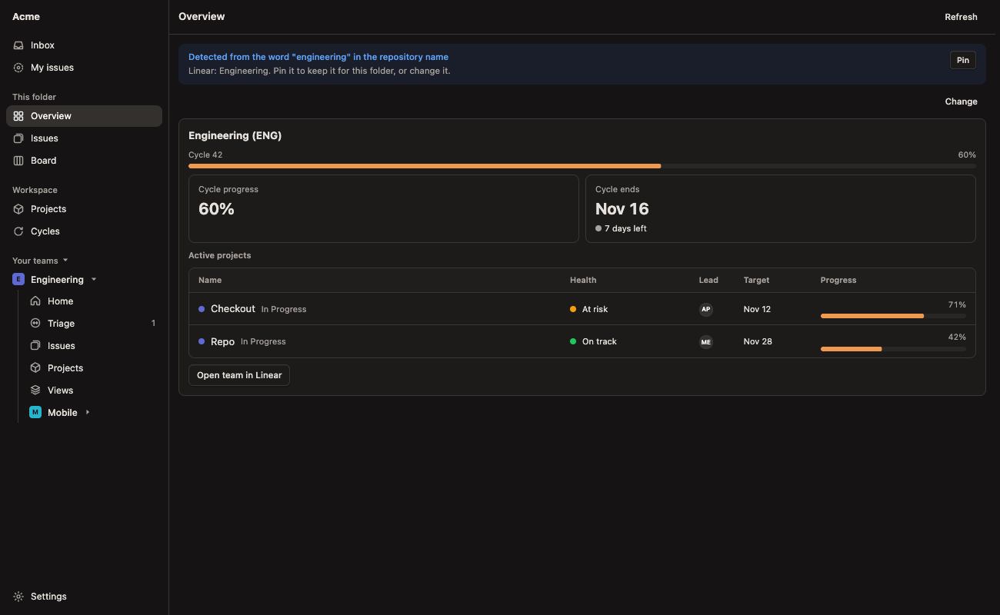
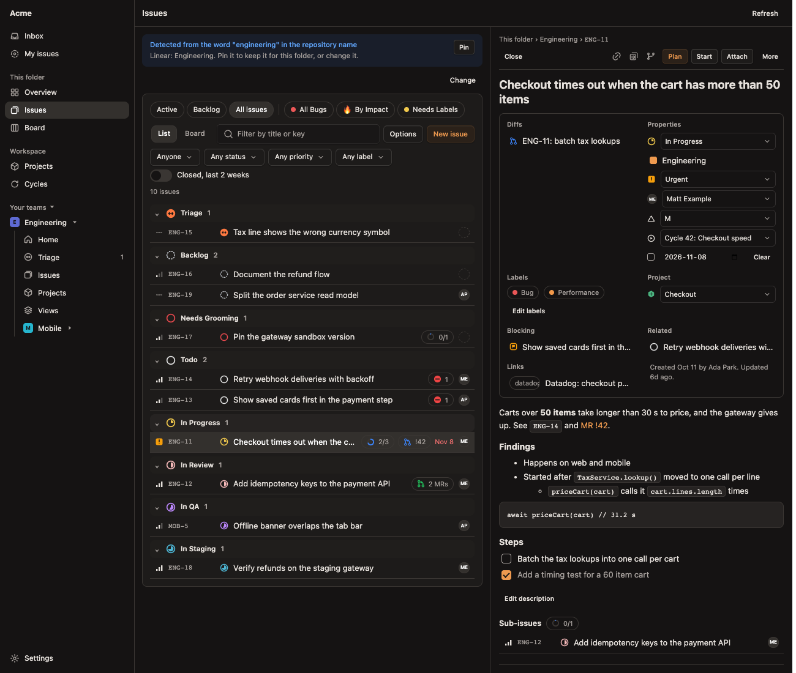
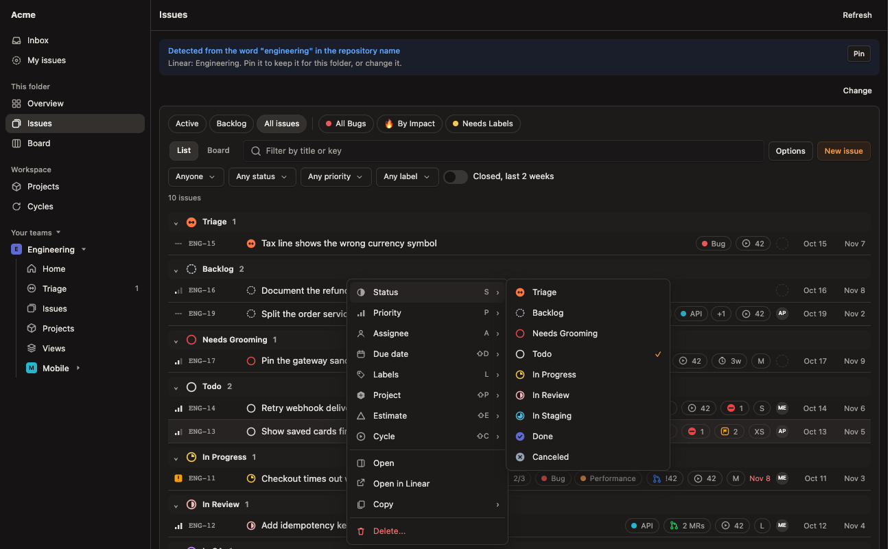
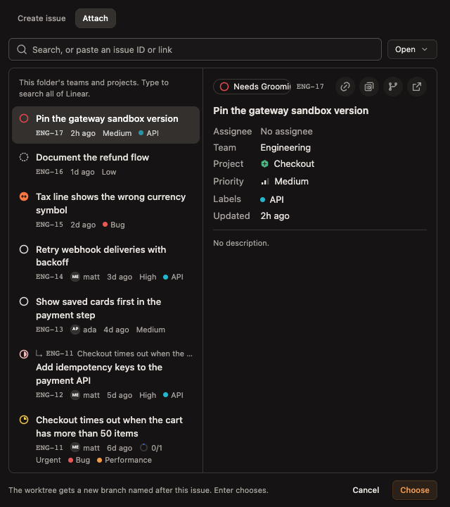

# Linear+

A Linear dashboard and agent toolkit for [OpenChamber](https://openchamber.dev). Browse and edit issues, follow projects and cycles, attach Linear work to sessions, and move from a plan to a build without leaving OpenChamber.

[Install Linear+](openchamber://extensions/install?url=https%3A%2F%2Fgithub.com%2Fs1rc%2Fopenchamber-linear-plus)



## Requirements

- OpenChamber desktop 2.7.0 or later. Extensions are not available in VS Code or on the phone. Running the plan and the build under one lead session needs 2.7.3 or later.
- A Linear workspace connected to OpenChamber.
- Optional: a Linear personal API key. It keeps agent context and `@` rows fresh while the dashboard is closed.

For development, you also need [Bun](https://bun.sh), a `shared-ui` checkout at `../shared-ui`, and Google Chrome for the browser tests.

## Install

1. Click [Install Linear+](openchamber://extensions/install?url=https%3A%2F%2Fgithub.com%2Fs1rc%2Fopenchamber-linear-plus) and approve the requested capabilities.
2. In OpenChamber, open **Settings → Integrations → Linear+** and connect Linear. Add a personal API key only if you want the optional background refresh.
3. Open **Linear+** from the rail or the full page. Its Work Status section appears when a project is open.

You can also add `https://github.com/s1rc/openchamber-linear-plus` directly in **Settings → Extensions**.

## Usage

### Dashboard

- Use **Inbox**, **My issues**, and the folder overview for your current work.
- Browse team **Home**, **Triage**, **Issues**, **Projects**, **Views**, and **Cycles**. Sub-teams appear under their parent.
- Switch issues between list and board, filter and group them, and drag cards between statuses. Blocking badges count only unfinished dependencies; completed dependencies appear under Related in the issue view.
- Right-click an issue row or card for an expanded Linear-style menu: edit properties, move teams, link releases, set SLA day counting, add links, customer requests and documents, create or mark relations, remove parent or dependency links, convert or copy issues, favorite, set reminders, open and delete. Find suggestions uses Linear's semantic issue search. Linear's shortcut keys work while the menu is open.
- Open an issue beside the list to edit its description and properties, including its project milestone, copy its ID, link or branch, and work with comments, relations, links, and sub-issues. Right-click a relation to change or remove it, or use its hover X to remove it. Sub-issues stay visible when empty and can be created in an inline drawer. Resources combines links and documents under the description, with add actions and inline document reading.
- The description edits as rich text, with a toolbar and Markdown shortcuts (`# `, `- `, `[] `, `> `); a Markdown tab shows what Linear stores. Tick a checklist box right in the description without opening the editor.
- Open a project for health, progress, updates, documents, and milestones. Select a milestone count to see its issues. Edit a project in place: its name, summary and description, status, priority, lead, members, teams and dates, and add, edit or delete milestones.
- Pin the detected team or project when a folder should keep a particular Linear scope. If the saved view, issue, project or team cannot be restored, Linear+ opens the issue named by the worktree prefix when one exists.





### Plan and build

1. Open an issue and click **Start plan**. Linear+ starts a planning session with the issue context and the team's estimate scale. The session interviews you about meaningful choices before finishing; a recommendation is not treated as your answer.
2. Review the plan. When enabled, Linear+ sets the estimate and creates split-out issues after the plan finishes.
3. Click **Start build** to hand the finished plan to a build session. Or click **Write Plan** to put the plan in the issue's description and stop, when someone else picks the work up. A plan over 6,500 characters is stored in full in an issue-linked document; the issue gets a concise plan of 2,500 to 6,500 characters with a link, aiming for 3,000 to 5,000 when the source has enough detail.

When a plan names other Linear issues, Write Plan and Start Build add a **Related repositories** section from their merge request, pull request, and project links. Repositories shared with the planned issue are left out. Split-out issues also name a different target repository in their descriptions.

When a session contains several plan replies, its **Start build from this plan** action includes a **Plan message** picker. The same action on a message uses exactly that message, for both Write Plan and Start build.

With **Run the plan and the build under one lead session** on (Settings, Plan and build), Start plan makes the worktree with one session, the lead. The lead starts the plan, and on Start build the build, as sessions nested under it. It always asks you every plan question and passes your answer back; during the build it answers questions itself where it can. With lead mode off, the plan and the build are sessions of their own, and the host leaves an empty first session in the worktree.

Agent and model defaults live in **Settings** (in the rail panel, the Settings button beside Refresh). A one-off model choice on Start plan or Start build does not change those defaults. The plan and build agents and models, After the build, Finish comments and Add the plan to the issue each have an **All folders** choice, and **This folder** overrides it in a pinned folder.

The plan estimate and split-out issues are the only writes Linear+ makes without a click. Comments, status changes, and project updates require an action from you. When a revised plan adds split-outs after an earlier write, only the newly named issues are created.

### Attach Linear work

Use the **+** menu, then **Linear+**, to attach an issue to a session or a new worktree. Search all of Linear, paste an issue key or URL, preview the issue, and choose it.



### Agent tools

- `@Linear+` attaches issues, projects, and documents as context. `@` alone lists the branch's issue and your open issues; type words or a key such as `ENG-123` to find one. Without the API key it finds the issues Linear+ has seen (yours, and any you opened in the dashboard); with the key it searches all of Linear.
- `/linear-issue ENG-123` shows a live issue card.
- `/linear-list ENG-1 ENG-2 My heading` shows a live issue list.
- `/linear-pick ENG-1 ENG-2 Which issue?` asks you to choose an issue for the agent.
- Right-click a `LinearIssue` card or a `LinearIssueList` row to edit status, priority, assignee, project, milestone, estimate, cycle, due date, and labels without leaving chat.
- Message, selection, chat, and diff actions can draft a new Linear issue.
- Session actions can start a build from a plan or comment on a linked issue.

### Work Status

The Work Status section summarizes open work and your assigned issues for the current folder. Beside a session, it surfaces only that session's finished plan and build handoff, plus draft finish comments.

## Development

Clone `shared-ui` beside this repository so `../shared-ui` exists, then run:

```bash
bun install
bun run build
bun run check
```

Useful checks:

```bash
bun run typecheck
bun test
bun run validate-queries
bun run smoke
bun run e2e
```

The screenshots in `docs/screenshots/` use only fake data from `scripts/fixtures.ts`. No real Linear workspace is contacted. See [TESTING.md](TESTING.md) for the full test matrix, screenshot harness, and manual checks.

## CI and releases

GitHub Actions runs `openchamber-guest-check` on pushes to `main` and on pull requests. The check validates the manifest and the committed built files without requiring the local `shared-ui` checkout.

To publish a release:

1. Raise `version` in `package.json`, and add the version's section at the top of [CHANGELOG.md](CHANGELOG.md).
2. Run the checks in [TESTING.md](TESTING.md), rebuild, and commit the source and built `.js` files.
3. Tag the commit as `vX.Y.Z`, matching the package version.
4. Push the commit and tag. The release workflow validates the package again and creates a GitHub release with the version's CHANGELOG section as its notes (generated notes when there is none).

OpenChamber installs from the repository, not from release assets. After a version increase, users update in **Settings → Extensions**.
